<div align="center">

# Even Odds

**A fair, verifiable lottery for oversubscribed community programs, where the database itself refuses an oversold seat, a split sibling pair and a second ticket for the same child.**

*Registration is a lottery, not a race. Frozen inputs, public randomness, and a draw anyone can replay.*


Appwrite Databases Hackathon 2026 · Database: **Appwrite TablesDB** · Solo build

**[Judge demo guide](docs/JUDGE-DEMO.md)** · [Draw algorithm](docs/DRAW-ALGORITHM.md) · [Freeze protocol](docs/FREEZE-PROTOCOL.md) · [Test report](docs/TEST-REPORT.md)

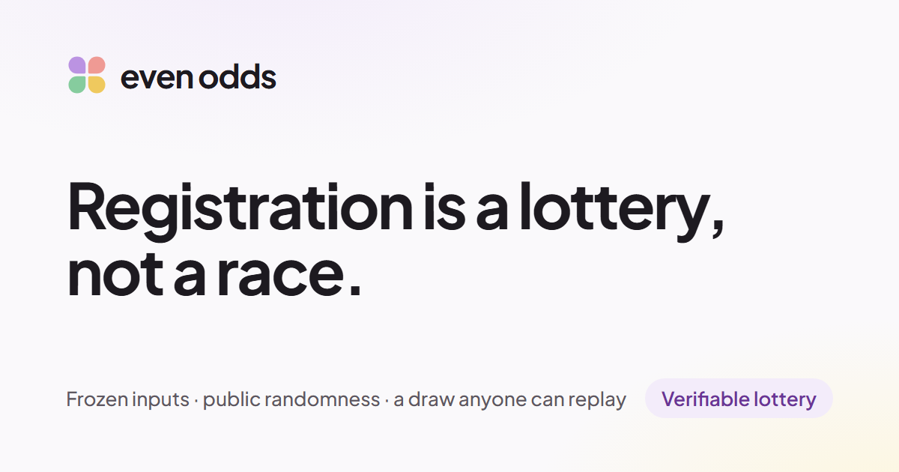

</div>

> [!IMPORTANT]
> **Synthetic families, real guarantees.** Every family, child, program and zone in this repository is invented: rows
> carry `synthetic: true` and names start with `[SYNTHETIC]`. The zones are drawn loosely over Fairfax, Virginia and are
> not official boundaries. What is real: the Appwrite Cloud database that enforces every rule, the live drand randomness
> beacon, and the news reports and research that motivate the design.

## At a glance

| | |
| --- | --- |
| **Problem** | Camps, swim lessons and garden plots open first-come registration at one moment. The fastest clicker wins, sites crash, siblings get split across weeks, and nobody can check the result. |
| **Solution** | Families apply any time in a window. Inputs are frozen and hashed, a drand round announced in advance seeds the draw, and one database transaction per family places siblings all-or-nothing. Anyone can replay the draw in their browser. |
| **Result** | On real Appwrite Cloud: **500 simultaneous attempts at one freed seat → exactly 1 placed**, 0 oversold seats and 0 split sibling pairs across all 8 load and race scenarios. The browser replay reproduces every committed placement. |
| **Proof** | SHA-256 inputs hash, a BLS-verified drand beacon, a hash-chained public audit log, and a fairness report card with a first-come comparison and permutation tests. |
| **Built with** | TypeScript · React 19 · Vite · Appwrite TablesDB, Auth and Functions · drand · Leaflet · Zod · Vitest · Playwright · axe-core |

---

## Contents

1. [The problem](#1-the-problem)
2. [What Even Odds does](#2-what-even-odds-does)
3. [Why this idea](#3-why-this-idea)
4. [Results](#4-results)
5. [System overview](#5-system-overview)
6. [How it works](#6-how-it-works)
   [Lifecycle](#61-lifecycle) ·
   [The draw](#62-the-draw) ·
   [Seats the database refuses](#63-seats-the-database-refuses) ·
   [Freeze and drand](#64-freeze-and-drand) ·
   [Offers and waitlist](#65-offers-and-waitlist) ·
   [Odds](#66-honest-odds) ·
   [Replay and fairness](#67-replay-and-fairness-report)
7. [The product](#7-the-product)
8. [Getting started](#8-getting-started)
9. [Judge demo in two minutes](#9-judge-demo-in-two-minutes)
10. [Project structure and tech stack](#10-project-structure-and-tech-stack)
11. [Testing](#11-testing)
12. [Security and privacy](#12-security-and-privacy)
13. [Who would use it](#13-who-would-use-it)
14. [Limitations and roadmap](#14-limitations-and-roadmap)
15. [Real and synthetic data](#15-real-and-synthetic-data)
16. [Reference: scripts, environment, docs](#16-reference)
17. [Editing the diagrams](#17-editing-the-diagrams)
18. [Sources](#18-sources)
19. [Team](#19-team)

---

## 1. The problem

Popular community programs have more applicants than places, and most still sell them **first-come, first-served at a
single moment**. That rewards the fastest connection, not need, and leaves families no way to check the result:

<p align="center">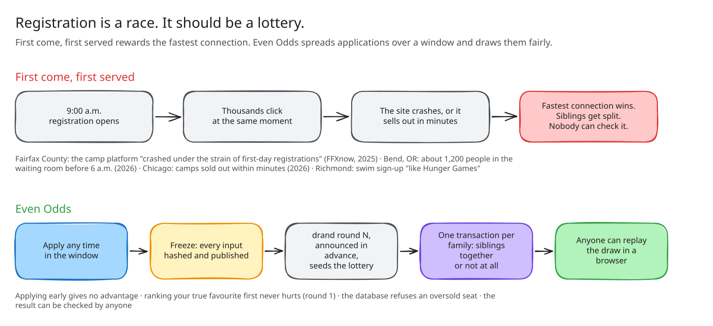</p>

| What happened | Source |
| --- | --- |
| Fairfax County's camp platform "crashed under the strain of first-day registrations"; the county split registration into zones with staggered openings. | FFXnow, Jan 2025 |
| Bend, Oregon: about **1,200 people** in the online waiting room before 6:00 a.m. | Central Oregon Daily, 2026 |
| Chicago Park District camps still sold out **within minutes** after an April 2026 overhaul. | Block Club Chicago, Apr 2026 |
| Swim registration described as "like Hunger Games", with "tens of thousands of parents" registering at once. | Richmond News (letter) |
| Cambridge MA and Girl Scouts of Central Texas run **sibling-aware lotteries by hand-written rules**; no vendor advertises it. | Official program pages |
| Scale: an estimated **14–26 million** US camp registrations a year across about 14,000 camps. | Secondary ACA figures |

Lotteries have their own failure modes, and each one shaped the design:

| Evidence | What goes wrong | Even Odds' answer |
| --- | --- | --- |
| DV-2012 green-card lottery voided; Franklin Towne Charter allegations (2023) | An operator can re-run a draw until they like the result | Inputs frozen and hashed **before** a pre-announced drand round exists; public replay |
| Massachusetts auditor: **2,342** probable duplicate charter applications | Two parents, two tickets for one child | The child is the ticket: a unique index on `(program, child_key)` |
| Dur, Morrill & Phan (2022); Correa et al. (2022) | Strict all-or-nothing hurts big families whose children span age groups | Three sibling modes and a seat ledger per `(week, age group)` |
| Boston school choice (NBER w11965); arXiv 2501.04243 | Live odds invite gaming | Banded hourly odds, frozen 24 h before close, with an honesty message |
| Gilsland Farm caps 3 weeks per child; SJMA gives everyone one week first | Families want several weeks | Snake draft: everyone gets one week before anyone gets a second |

<details>
<summary><b>New to the terms? A 30-second glossary</b></summary>

| Term | Meaning |
| --- | --- |
| **Window** | The period when families can apply. Applying early gives no advantage. |
| **Tier** | A priority group set by the organiser, for example residents first. Decided from the home location against zone polygons. |
| **Sibling mode** | *Together only* (all siblings in the same week or none), *together preferred* (try together, then separately), or *independent*. |
| **Snake draft** | Round 1 goes through the lottery order forwards, round 2 backwards, and so on, so no family gets two weeks before everyone has had a turn. |
| **Freeze** | When applications close, every input is serialised canonically, hashed with SHA-256 and published in one transaction. |
| **drand** | A public randomness beacon run by the League of Entropy. Each round's value is unknowable before it is produced and is signed (BLS). |
| **Replay** | Rerunning the same lottery code in your own browser from the public inputs and the drand value, then comparing every placement. |

</details>

## 2. What Even Odds does

| # | Capability | What it means |
| --- | --- | --- |
| 1 | **Apply during a window** | Families sign in with an email code, add children, rank weeks, request up to K weeks per child and choose a sibling mode. Submission time is not an input to the lottery. |
| 2 | **Two parents, one ticket** | A keyed hash of the child's normalised name, birthdate and program is unique. A second household is refused and the original household gets a link request instead. |
| 3 | **Honest odds** | A Monte Carlo estimate per tier, shown as a band (*Likely*, *About even*), never a precise percentage, recomputed hourly and frozen 24 h before close. |
| 4 | **Priority zones** | Organisers draw zone polygons; a home point inside one sets the claimed tier, and homes near a boundary are flagged for verification. |
| 5 | **Tamper-evident draw** | Inputs frozen and hashed, randomness from a drand round announced at publish, a hash-chained public audit log. |
| 6 | **Siblings all-or-nothing** | Each family's placement is one TablesDB transaction with capped seat counters. If any sibling's seat is full, the whole family rolls back. |
| 7 | **Offers and waitlist** | 48-hour offers; declines and expiries release the seat and promote the next child in strict lottery order, inside transactions. |
| 8 | **Public verification** | `/replay/:programId` reruns the draw in the browser; `/fairness/:programId` reports placement rates, a first-come counterfactual and bias tests. |

<p align="center">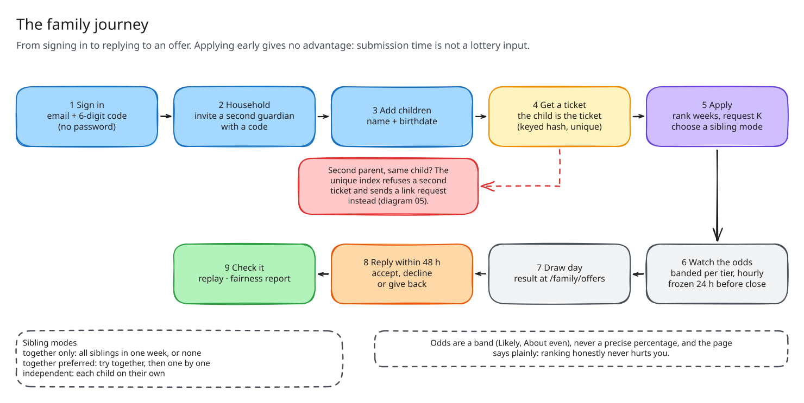</p>

<p align="center">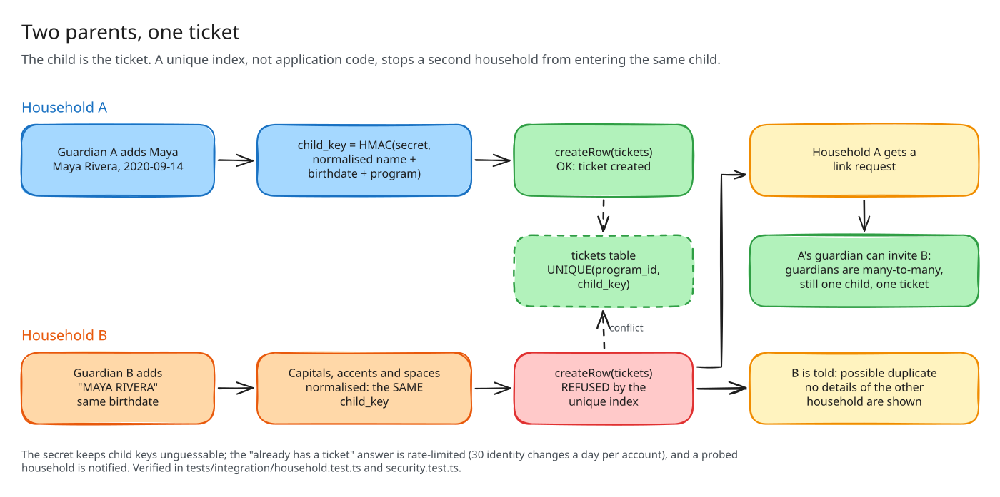</p>

**Why a lottery.** A lottery spread over a window removes the reason to rush. Everyone who applies on time has the same
chance within their tier, and the first round of the draft is strategy-proof: ranking your true favourite first never
hurts you.

**Why TablesDB.** The judging criterion asks how deliberately the database is used. In Even Odds every guarantee is a
database feature, not application code that could be wrong under load:

| TablesDB feature | Job in Even Odds | Where |
| --- | --- | --- |
| `incrementRowColumn` with `max` | A seat ledger per `(week, age group)` that **cannot** exceed capacity | [`functions/shared/placement.ts`](functions/shared/placement.ts), [`db.ts`](functions/shared/db.ts) |
| Transactions | A sibling group all-or-nothing; release-and-promote a seat atomically; freeze inputs in one step | [`placement.ts`](functions/shared/placement.ts), [`offers.ts`](functions/shared/offers.ts), [`freeze.ts`](functions/shared/freeze.ts) |
| Unique indexes | One ticket per child; one placement per `(child, week)`; idempotency keys | [`shared/schema.ts`](shared/schema.ts) |
| Geo columns, `Query.intersects`, `distanceLessThan` | Point-in-zone tiers; near-boundary flag | [`functions/shared/organiser.ts`](functions/shared/organiser.ts) |
| Operators | Server-clock offer expiry and in-place updates | [`offers.ts`](functions/shared/offers.ts) |
| Row-level permissions and Teams | Families see only their rows; organisers see tiers, not homes; the public sees demand and the audit log | [`functions/shared/permissions.ts`](functions/shared/permissions.ts) |
| Realtime | One public odds row per program, live on the program page | [`src/features/lottery/useLiveOdds.ts`](src/features/lottery/useLiveOdds.ts) |
| Bulk upserts | Seed a judge sandbox in a handful of calls | [`functions/shared/sandbox.ts`](functions/shared/sandbox.ts) |

## 3. Why this idea

The idea was chosen in three rounds before any code was written: research candidates, cut weak or already-taken ones,
score the finalists on the four judging criteria, then check the survivors against existing tools.

| Round | Candidates | Winner | Why |
| --- | --- | --- | --- |
| 1. Broad research | 24 problems | Roll Call (missing-person reconciliation, VectorsDB) | Strong permissions story, but synthetic data only and a disaster theme already crowded |
| 2. First principles | 15 more, in 3 under-explored classes | **Even Odds** (TablesDB) | Real evidence, judges can try it, and it uses TablesDB 2.0 features for their real purpose |
| 3. Past-winners check | Hacktoberfest 2024 top 3 | Even Odds | Scored 33.5 against 26, 22 and 20 on the 2026 criteria |

| Finalist | Idea | Tech | Design | DB use | Overall |
| --- | ---: | ---: | ---: | ---: | ---: |
| **Even Odds** (TablesDB) | 6.5 | 9 | 8 | **10** | **33.5** |
| Chorus (VectorsDB) | 7 | 9 | 8 | 8 | 32.5 |
| Roll Call (VectorsDB) | 8 | 8 | 8 | 10 | 32 |
| Recall ledger (DocumentsDB) | 6 | 8 | 6 | 9 | 30 |

> [!NOTE]
> These scores are judgement, not measurement. "Overall" is the criterion sum adjusted for data realism, overlap with
> public entries and build risk. The full reasoning is in [docs/EvenOdds-design-brief.pdf](docs/EvenOdds-design-brief.pdf).

## 4. Results

Every number below was read from **committed rows on Appwrite Cloud** (Free plan) after the race, never from return
values or staged transaction values. Evidence files: [`docs/test-evidence/stress/`](docs/test-evidence/stress/).

| Scenario | Committed outcome |
| --- | --- |
| **500 simultaneous attempts at one freed seat** | 1 placed, 499 `no_capacity`; ledger `taken 1/1` |
| **500 waitlisted families, 50 duplicate promotion jobs, then 500 simultaneous accepts** | Exactly 1 promotion (to position 1); 1 `changed`, the rest replayed or unchanged; `taken 1/1` |
| **Nearly full session** (capacity 40, 35 taken; 100 singles + 50 sibling pairs) | Exactly `40/40`, 0 split pairs; throttled retries **replayed instead of double-booking** |
| **60 sibling pairs across two age groups**, plus 10 singles | Young `6/6`, old `0/4`, 0 split pairs: each pair's second seat rolled back with the first |
| **40 copies of one placement request** | 1 `placed`, 39 `replayed`; `taken 1/5` |
| **30 accepts of one offer, no idempotency key** | 1 `changed`, 29 `unchanged` after conflict retries |
| **4 concurrent draw workers, cursor reset mid-run** | All 4 `completed`; placements exactly equal the plan (19/19) |
| **8 sweeps + 8 expiry/promotion jobs at once** | Each of 20 seats released once; 20 promotions in strict order |

**In short:** across 8 load and race scenarios, the database never showed an oversold seat, a split "together only"
group, a double placement or a seat released twice. The run history is published unfiltered in the
[test report](docs/TEST-REPORT.md#run-history-not-cherry-picked), including the real defect it found (duplicate
requests at the last seat) and the fix.

**The judge-demo draw** (16 synthetic families, 26 children, 31 seats), as the public fairness report computes it in
the browser: **29/31** seats allocated, **0** oversold, **15/16** families with at least one week, **25/26** children
with a week, 0 "together only" families split. The replay reproduced all 29 placements and 8 waitlist positions.

> [!NOTE]
> The demo has 16 families, so every fairness group is flagged *small sample*. The permutation test was calibrated on 12
> synthetic programs of 160 families: the lottery's application-time p-values ranged 0.12–0.80, while the first-come
> baseline's sat at the floor every time. See [docs/FAIRNESS.md](docs/FAIRNESS.md).

## 5. System overview

<p align="center">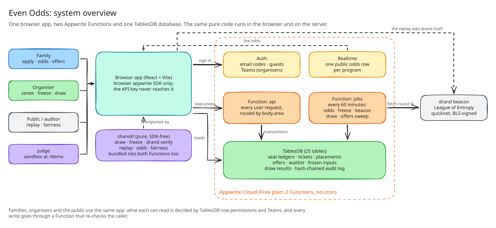</p>

| Part | Owns | Never does |
| --- | --- | --- |
| [`src/`](src/) (React, Vite) | Family, organiser, public verification and judge-demo screens; the browser replay | Hold the API key or import server code (enforced by ESLint) |
| [`shared/`](shared/) (pure TypeScript) | The draw, freeze canonicalisation, drand verification, replay, odds and fairness maths | Talk to Appwrite: it is SDK-free so browser and server run **the same code** |
| [`functions/api`](functions/api/) | Every user request, routed by `body.area`: household, organiser, offers, console, demo | Trust a tier, capacity or program ID from the caller |
| [`functions/jobs`](functions/jobs/) | The 60-minute interval: odds, freeze, drand beacon, advancing draws, offer sweeps, sandbox clean-up | Pick a new drand round after seeing output |
| [`scripts/`](scripts/) | Schema provisioning (25 tables), diagnostics, seeding, migrations, deploys | Run in the browser |

The Appwrite Free plan allows **two Functions** per project and no cron, so all server logic lives in `api` and
`jobs` (see [docs/VERIFIED-BEHAVIOUR.md](docs/VERIFIED-BEHAVIOUR.md)).

## 6. How it works

### 6.1 Lifecycle

<p align="center">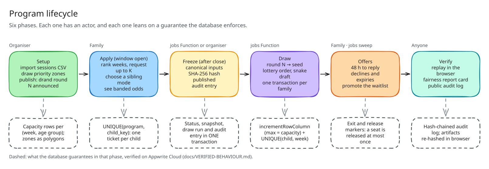</p>

### 6.2 The draw

The draw is one pure module, [`shared/draw/`](shared/draw/), used by both the server and the browser replay, so they
cannot disagree. Full specification: [docs/DRAW-ALGORITHM.md](docs/DRAW-ALGORITHM.md).

<p align="center">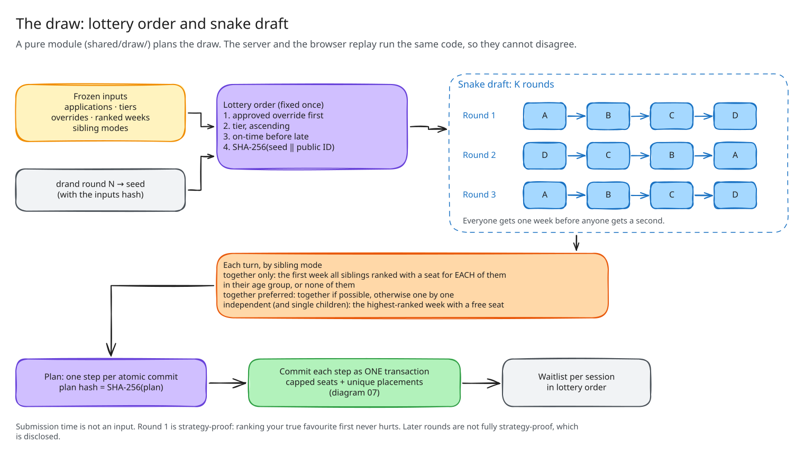</p>

**Lottery order**, fixed once, sorted by:

1. Priority class: an approved pre-freeze override first.
2. Tier, ascending.
3. On-time before late.
4. Lottery hash: `SHA-256(seed ‖ publicId)`, where the seed comes from drand round N.

Submission time is not an input. **Snake draft** over rounds `1…maxWeeks`: odd rounds go forwards, even rounds
backwards, and each family whose children still want weeks gets one turn per round.

| Sibling mode | Behaviour |
| --- | --- |
| `together_only` | All siblings still wanting weeks go into the first week they all ranked that has a seat for **each** of them in their age group, or none of them do |
| `together_preferred` | As above; if no such week exists, each child is placed on their own |
| `independent` | Each child takes their highest-ranked week with a free seat |

The module **plans**, the database **enforces**: each plan step is committed as one transaction, in parallel batches,
because the capped counters and unique indexes make concurrency safe.

### 6.3 Seats the database refuses

Before building on it, the critical behaviour was tested on Appwrite Cloud. It found one **design-breaking** trap:

| Experiment | Observed on Appwrite Cloud |
| --- | --- |
| `updateRow({ taken: Operator.increment(1, max) })` at the cap | **No error, no change.** A sold-out seat would look booked. Never used for seats. |
| `incrementRowColumn({ value: 1, max })` at the cap | Throws `400 column_limit_exceeded`; the counter stays put |
| Capped increment **staged** in a transaction on a full ledger | Staging succeeds with a mock value; the **commit** throws `attribute_limit_exceeded` |
| Sibling group: ledger A has room, ledger B is full, both in one transaction | Commit fails; **A stays unchanged and no placements exist** |
| 20 concurrent placements on a capacity-3 ledger | Exactly 3 placed, 17 `no_capacity` |

<p align="center">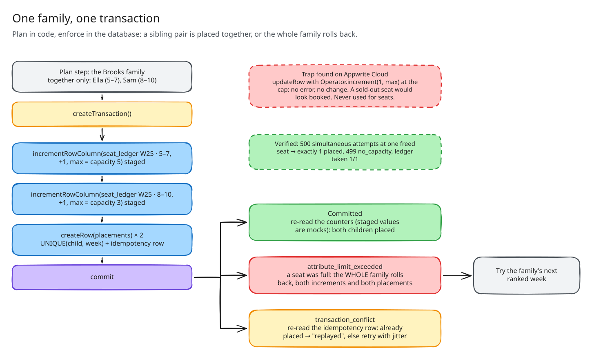</p>

Because staged values are mocks, results always come from a **post-commit re-read**. A unique violation and an
optimistic conflict both surface as `transaction_conflict`, so `placeGroup` re-reads its idempotency row to tell them
apart before retrying with jitter. All of this is in [docs/VERIFIED-BEHAVIOUR.md](docs/VERIFIED-BEHAVIOUR.md), each row
naming the test that re-checks it.

### 6.4 Freeze and drand

<p align="center">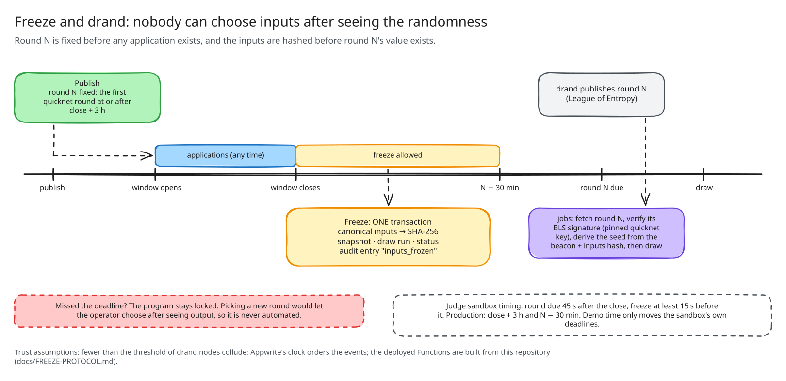</p>

1. **Announce at publish.** The program commits to quicknet round `N = first round at or after window_close + 3 h`.
   N depends only on the close time, which is locked once the program is published.
2. **Freeze after close, before `N − 30 min`.** Inputs are serialised canonically (pseudonymous IDs, tiers,
   preferences, overrides), hashed with SHA-256, and published with an audit entry **in one transaction**.
3. **Beacon.** Once round N exists, the `jobs` Function fetches it, verifies its BLS signature against the pinned
   quicknet key, and derives the seed from it and the inputs hash.
4. **Missed deadline?** The program stays locked. Choosing a new round would let the operator pick after seeing output,
   so it is deliberately not automated.

Trust assumptions and what the protocol does **not** prove are written out in
[docs/FREEZE-PROTOCOL.md](docs/FREEZE-PROTOCOL.md#trust-assumptions).

### 6.5 Offers and waitlist

<p align="center">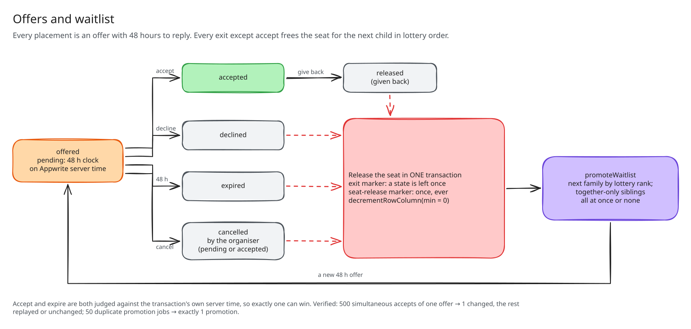</p>

Offers last 48 hours, measured on Appwrite's server clock. A decline, a give-back or an expiry releases the seat and
promotes the next waiting child **in lottery order** in the same transaction. Duplicate sweeps, duplicate promotion jobs
and hundreds of simultaneous accepts are all idempotent. Details:
[docs/OFFERS.md](docs/OFFERS.md).

### 6.6 Honest odds

[`shared/odds.ts`](shared/odds.ts) simulates the published draw rules (Monte Carlo, seeded, up to 2,000 iterations)
every hour and shows, per tier, a **band** of the chance of getting at least one week, plus demand per seat. It never
shows a precise percentage, never shows a tier with fewer than 5 children, freezes 24 h before close, and tells
families that ranking honestly never hurts them. Details: [docs/ODDS.md](docs/ODDS.md).

### 6.7 Replay and fairness report

<p align="center">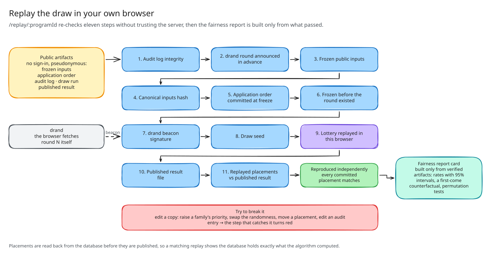</p>

- **Replay** (`/replay/:programId`): verifies the audit hash chain, the drand round and signature, the inputs hash, the
  seed and the plan hash, then recomputes every placement in the browser. A *Try to break it* panel edits a copy of the
  bundle so you can watch verification fail. Details: [docs/REPLAY.md](docs/REPLAY.md).
- **Fairness report card** (`/fairness/:programId`): built only from artifacts that passed the replay. It shows
  placement rates with 95% Wilson intervals by application time, family size and tier; a **first-come counterfactual**
  on the same families and seats; and stratified permutation tests. It says "no evidence of an association at this
  sample size", never "fair". Details: [docs/FAIRNESS.md](docs/FAIRNESS.md).

## 7. The product

| Judge demo and database inspector | Replay the draw |
| --- | --- |
| 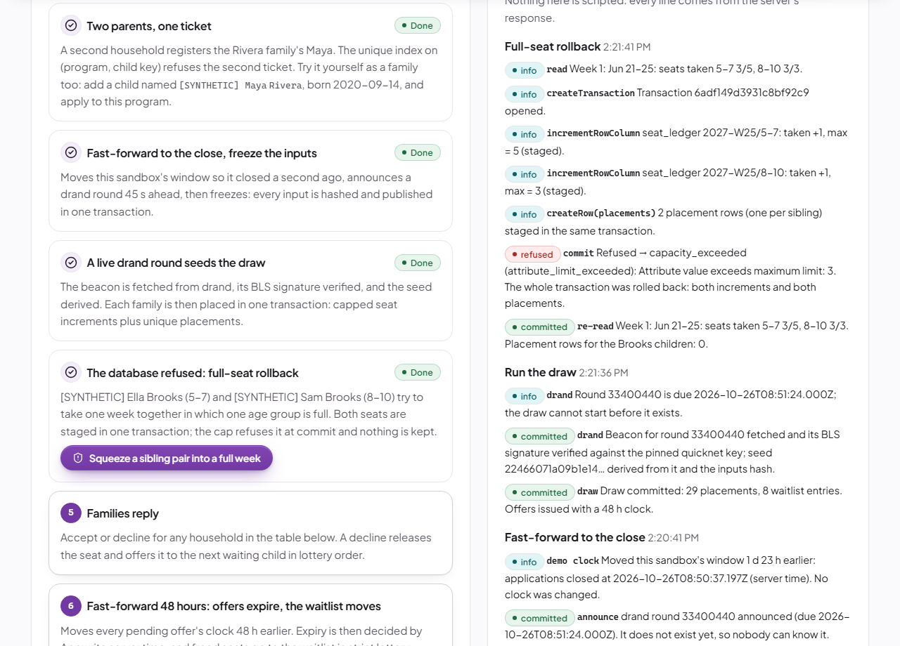 | 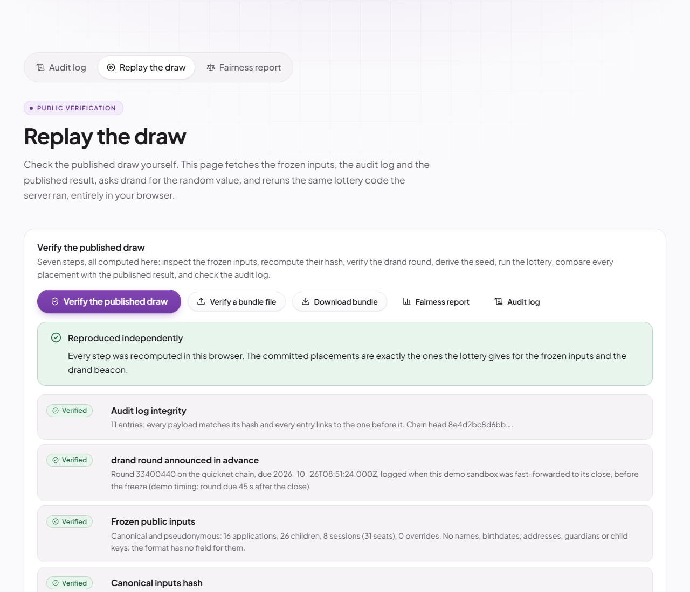 |
| **Fairness report card** | **Organiser console: demand** |
| 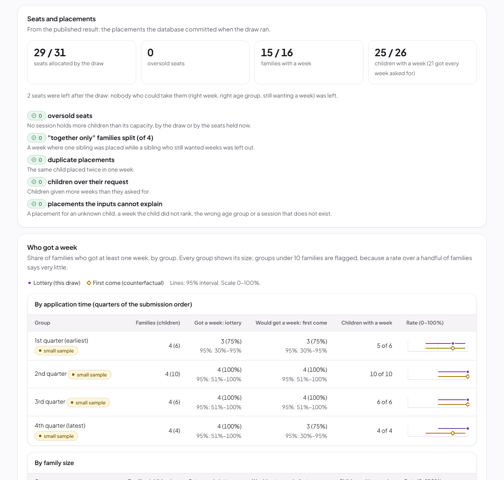 | 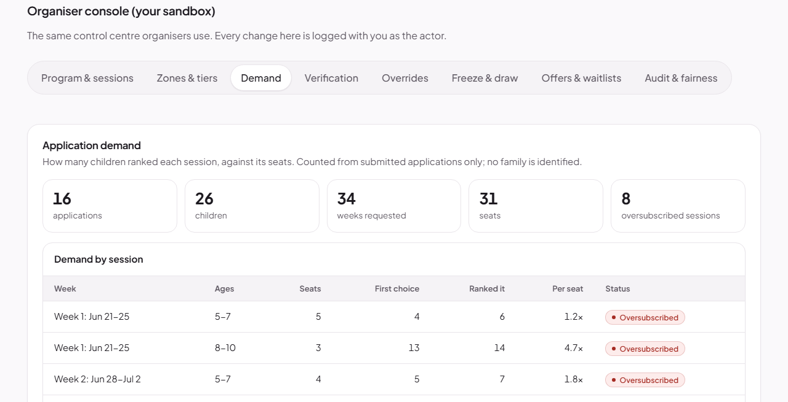 |

**Designed for families, not engineers.**

- **Plain language.** The inspector shows each database call as a sentence beside its raw operation name.
- **Honest by default.** Synthetic data carries a badge; live, unhashed values are labelled as the server's word; a
  failed check shows why instead of a fallback.
- **Light and dark themes**, reduced motion respected, and no sideways scrolling at 320 px.
- **Accessible maps.** Every map lists its zones and tiers as text, and a home location can be entered by keyboard.
- **Roles.** Families at `/family`, organisers at `/organiser` (an Appwrite Team), and the public at `/programs`,
  `/replay` and `/fairness`.

<p align="center">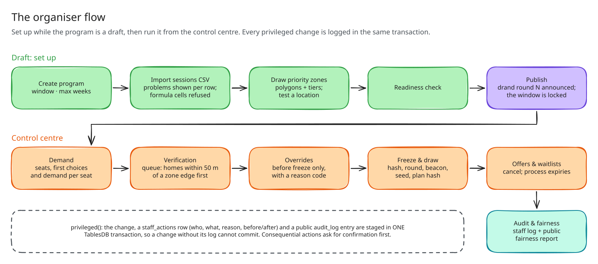</p>

## 8. Getting started

**Prerequisites:** Node.js **22.12+** (developed on 22.17) and an Appwrite Cloud project
([docs/APPWRITE-SETUP.md](docs/APPWRITE-SETUP.md) lists the API key scopes).

```sh
npm install
cp .env.example .env.local          # public browser config
cp .env.server.example .env.server  # server-only secrets (git-ignored)
# fill both files in, then:
npm run diagnose                    # checks key, connection and schema
npm run db:provision                # creates the TablesDB schema (safe to rerun)
npm run functions:deploy            # builds and deploys the api + jobs Functions
npm run setup:organisers            # creates the organiser Team ("organisers")
npm run seed:demo                   # publishes the SYNTHETIC demo program
npm run seed:applicants             # adds 120 SYNTHETIC households (-- --reset removes them)
npm run odds:run                    # computes odds now (the jobs Function does this every 60 min)
npm run dev                         # http://localhost:5173, see /status

# Make yourself an organiser: sign in once at /signin, then
npm run setup:organisers -- --add-email you@example.com
```

Missing or invalid configuration never produces a blank page: the app shows which variables are wrong, and scripts exit
with a list of problems. The variables are listed in [Reference](#16-reference).

> [!TIP]
> **Email codes stop arriving?** Appwrite Cloud allows about 10 email codes an hour per IP address. Wait for the hour
> to pass, or use the judge demo, which needs no email at all.

## 9. Judge demo in two minutes

Open **`/demo`** and press **Start the judge demo**. No sign-up: a guest session gets its own private, pre-seeded
sandbox (16 synthetic families, 8 sessions, 2 zones, three sibling modes). Every control runs the **production code**
against real TablesDB rows, and the **Database inspector** shows what the database answered.

<p align="center">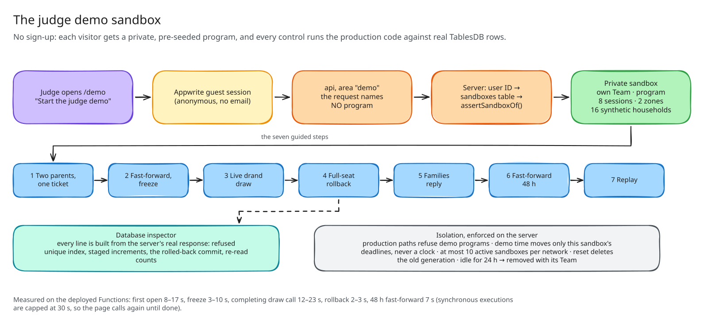</p>

| Step | What to press | What the database does | Measured |
| --- | --- | --- | --- |
| — | Start the judge demo | Private Team, program, sessions, zones and households via bulk upserts; tiers from `Query.intersects` | 8–17 s |
| 1 | Two parents, one ticket | `createRow(tickets)` refused by `UNIQUE(program_id, child_key)`; a link request goes to the original household | — |
| 2 | Fast-forward to the close | The sandbox's own window moves (no clock changes); round announced; status, snapshot, draw run and audit entry committed in **one transaction** | 3–10 s |
| 3 | Run the draw | Waits for the live drand round, verifies its BLS signature, commits one transaction per family, issues 48 h offers | 12–23 s |
| 4 | Squeeze a sibling pair into a full week | Both capped increments and both placements staged; commit refused with `attribute_limit_exceeded`; counts unchanged | 2–3 s |
| 5 | Families reply | Accept or decline as any household; a decline promotes the next child in lottery order | — |
| 6 | Fast-forward 48 hours | Offer clocks move 48 h; the real sweep expires them by server time and promotes the waitlist | 7 s |
| 7 | Replay the draw | Your browser fetches the beacon, re-verifies everything and recomputes every placement | — |

Below the script is the full **organiser console** for the sandbox. Sandboxes are isolated server-side: the browser
never names a sandbox, production paths refuse demo programs, and idle sandboxes are removed after 24 h. Details:
[docs/JUDGE-DEMO.md](docs/JUDGE-DEMO.md) and [docs/ORGANISER-CONSOLE.md](docs/ORGANISER-CONSOLE.md).

## 10. Project structure and tech stack

```text
even-odds/
├── src/                 browser app (React, Vite); may only use the browser `appwrite` SDK
│   ├── app/             router, layout, providers, route pages
│   ├── components/      shared UI
│   └── features/        auth · family · programs · applications · lottery · offers · audit ·
│                        fairness · organiser · console · demo
├── shared/              pure, SDK-free code used by browser AND server
│   ├── draw/            the lottery (plan, snake draft, sibling modes)
│   ├── freeze/          canonical inputs, drand verification, timing protocol
│   └── replay/          bundle, replay, diff, tamper checks
├── functions/           server-only code (holds the API key)
│   ├── shared/          typed DB layer, placement, offers, freeze, draw runner, audit, sandbox, rate limits
│   ├── api/             every user request, routed by body.area (household · organiser · offers · console · demo)
│   └── jobs/            60-minute interval: odds, freeze, beacon, draws, offer sweeps, sandbox clean-up
├── scripts/             provisioning, diagnostics, seeding, migrations, deploys, brand assets
├── tests/               unit · integration (real Appwrite) · stress · e2e · e2e-live
├── data/demo/           synthetic catalogue (sessions.csv, zones.geojson)
└── docs/                design brief, protocols, schema, verified behaviour, test report, screenshots
```

`shared/` sits at the root rather than in `functions/shared/` because the browser replay must import the same
deterministic code, while `functions/` is off-limits to browser code.

| Layer | Technology |
| --- | --- |
| Frontend | React 19, React Router 7, TypeScript (strict), Vite 8, Leaflet with react-leaflet, lucide-react |
| Backend | Appwrite Cloud: TablesDB, Auth (email OTP, anonymous guest sessions, Teams), Functions (Node 22), Realtime |
| Randomness and crypto | drand quicknet via `drand-client` (BLS12-381), SHA-256, canonical JSON, hash-chained audit log |
| Validation | Zod schemas shared by browser and server |
| Testing | Vitest, Testing Library, Playwright (Chromium), `@axe-core/playwright` |

## 11. Testing

| Suite | Command | Result |
| --- | --- | --- |
| Unit (offline) | `npm test` | **281 passed** (25 files) |
| Browser, offline | `npm run test:e2e` | **76 passed**, including 37 accessibility tests (axe on 15 routes, light and dark) |
| Browser, live | `npm run test:e2e:live` | **1/1**: the full judge walkthrough on the deployed backend, axe on 10 screens |
| Integration | `npm run test:integration` | **160 passed** against real Appwrite: never mocked, never skipped |
| Load and races | `npm run test:stress` | **8/8**, about 14–20 minutes; evidence in [`docs/test-evidence/stress/`](docs/test-evidence/stress/) |
| Static | `npm run check` | Typecheck, lint (including the browser/server import boundary), unit tests and build |

Counts other than the unit suite are from the release [test report](docs/TEST-REPORT.md), which lists the environment,
the repeatable procedure, every failing run and the open issues.

> [!TIP]
> Run the Appwrite-hitting suites **one at a time**, and the integration suite in its own hour. Appwrite Cloud Free
> throttles bursts per IP and allows about 10 email codes an hour.

<details>
<summary><b>Manual checks (things that cannot be automated)</b></summary>

1. **Sign in with a real email code:** open `/signin`, enter your email, then the 6-digit code. You land on `/family`.
   A wrong code shows an error and creates no session; an expired code (15 minutes) shows an expired message; "Resend
   code" counts down for 60 s.
2. **Household:** create a household, add a child, invite a second account with the code shown, and join from a
   private window. Both accounts see the child; a third account sees nothing.
3. **Duplicate child:** in a separate household, add the same child (any capitalisation or accents) and choose "Get
   ticket" for the demo program. You get a warning with no details of the other household, and the original household
   sees a notice.
4. **Organiser:** add yourself with `npm run setup:organisers -- --add-email`, open `/organiser`, create a program,
   paste a CSV with mistakes (see the row-level problems), import a valid one, draw a zone, test a location, check
   readiness, publish, then find it at `/programs`.

</details>

## 12. Security and privacy

- **The API key never reaches the browser.** ESLint enforces the import boundary; the key lives only in the two
  Functions.
- **Families are isolated.** Family B gets 404 for family A's children, placements and offers, and editing,
  registering or applying with A's child returns `not_found`. Guests get 401 before any code runs; families get 403 from organiser areas.
- **The server decides.** Tiers, capacity and program IDs from the caller are rejected or ignored; capacity is always
  read from the ledger row.
- **Rate limits** on identity changes, applications, invites and offer replies, enforced by a capped
  `incrementRowColumn` on a `rate_limits` table.
- **Children's data.** The duplicate check uses a keyed HMAC of the normalised name and birthdate. Published draw inputs
  hold no names, birthdates, addresses, guardians or child keys, and override reasons stay in the staff-only log.
- **Hardened imports.** CSV formula injection is refused, malformed GeoJSON is reported as errors, and errors never
  return stack traces, secrets or server paths.

An independent review found 9 issues (none critical or high); each one is fixed or listed as open in the
[test report](docs/TEST-REPORT.md#security-review).

## 13. Who would use it

| User | What Even Odds gives them |
| --- | --- |
| **Families** | Apply when it suits them, see honest odds, keep siblings together, and check the result themselves |
| **Parks and recreation staff** | A lottery layer beside an existing registration system: catalogue import, priority zones, a verification queue that puts homes near a zone edge first, an audited draw |
| **Auditors, journalists, councillors** | Demand, the inputs hash, the drand round, a replay and a fairness report, without seeing anyone's personal data |

**Beyond camps.** The same pattern fits any place that is oversubscribed at one moment: swim lessons, garden plots,
school-place lotteries, and blockbuster opening days (Baahubali 2 sold more than a million advance tickets on
BookMyShow in 24 hours).

## 14. Limitations and roadmap

| Limitation | What we'd do next |
| --- | --- |
| The freeze-before-round claim rests on Appwrite's clock. | Publish the inputs hash outside Appwrite at freeze time (a timestamping service). |
| The protocol proves inputs were not changed, not that they are **true** or complete. | Staff verify claimed tiers with logged reason codes; add an external eligibility check. |
| Rounds after the first are not fully strategy-proof (a known result for multi-round drafts). | Disclosed on the site; consider a single-round variant for small programs. |
| Free-plan burst throttling (1–235 of 500 simultaneous requests got 429). | Retries are safe and built in; re-run `test:stress` on a paid plan before a large launch. |
| No manual screen-reader pass yet (NVDA or VoiceOver). | One pass of sign-in, apply, offers and replay before launch. |
| Separate accommodation capacity (aides) is not modelled; overrides move a family ahead of every tier. | Add an accommodation seat pool per session. |
| No payments or deposits: the flow ends at an accepted offer. | Add a staff deposit flag; hand accepted offers to the organiser's existing registration system. |
| Not verified: real email delivery, Realtime near 250 connections, load from many IP addresses. | Test on a staging project with distributed clients. |

## 15. Real and synthetic data

| Real | Synthetic |
| --- | --- |
| Appwrite Cloud TablesDB: every rule above is enforced by the live database | Every family, child, program and session ([`data/demo/sessions.csv`](data/demo/sessions.csv)) |
| The drand quicknet beacon, fetched and BLS-verified live | Zone polygons drawn loosely over Fairfax, VA ([`data/demo/zones.geojson`](data/demo/zones.geojson)), not official boundaries |
| The news reports, audits and research in [Sources](#18-sources) | The 120 seeded applicant households and the 16 judge-sandbox families |

## 16. Reference

<details>
<summary><b>Scripts</b></summary>

| Command | What it does |
| --- | --- |
| `npm run dev` / `build` / `preview` | Vite dev server, production build, preview |
| `npm run typecheck` | Strict TypeScript across app, server and tests |
| `npm run lint` | ESLint (type-aware), including the browser/server import boundary |
| `npm test` | Unit tests (jsdom/node, no network) |
| `npm run test:integration` | **Real** tests against the Appwrite project in `.env.server` |
| `npm run test:stress` | Load and race suite (hundreds of simultaneous real transactions); evidence to `docs/test-evidence/stress/` |
| `npm run test:e2e` | Playwright browser tests, including the WCAG 2.1 AA audit (`tests/e2e/a11y.spec.ts`) |
| `npm run test:e2e:live` | Real browser walkthrough of the judge demo against the deployed backend (creates and removes one sandbox) |
| `npm run smoke:demo` | The judge script against the deployed `api` Function, with timings |
| `npm run check` | Typecheck + lint + unit tests + build |
| `npm run db:provision` / `db:check` | Create / verify the TablesDB schema |
| `npm run diagnose` | Server-side connection and schema diagnostics |
| `npm run docs:schema` | Regenerate [docs/SCHEMA.md](docs/SCHEMA.md) |
| `npm run functions:build` / `functions:deploy` | Bundle / deploy the `api` and `jobs` Functions |
| `npm run setup:organisers` | Create the organiser Team; `-- --add-email` adds a member |
| `npm run seed:demo` | Create and publish the synthetic demo program (idempotent) |
| `npm run seed:applicants` | Add 120 synthetic households; `-- --reset` removes them |
| `npm run odds:run` | Compute odds now |
| `npm run brand:render` | Re-render the PNG icons and social preview in `public/` |
| `npm run db:migrate:001` / `002` / `003` | Migrations (households; `cancelled` offer state; ticket permissions). Dry run unless `-- --apply`; see [docs/MIGRATIONS.md](docs/MIGRATIONS.md) |

</details>

<details>
<summary><b>Environment variables</b></summary>

Browser (`.env.local`, all `VITE_` prefixed, **not secret**):

| Variable | Required | Meaning |
| --- | --- | --- |
| `VITE_APPWRITE_ENDPOINT` | yes | API endpoint ending in `/v1` |
| `VITE_APPWRITE_PROJECT_ID` | yes | Project ID |
| `VITE_APPWRITE_DATABASE_ID` | yes | TablesDB database ID (default `even-odds`) |
| `VITE_APPWRITE_ORGANISER_TEAM_ID` | no | Organisers' Team ID |
| `VITE_APPWRITE_TABLE_*` | no | Override a table ID (defaults to the canonical name) |
| `VITE_LOG_REQUESTS` | no | `true` logs request summaries in production builds |

Server (`.env.server`, **secret**, never bundled):

| Variable | Required | Meaning |
| --- | --- | --- |
| `APPWRITE_ENDPOINT`, `APPWRITE_PROJECT_ID`, `APPWRITE_DATABASE_ID` | yes | As above |
| `APPWRITE_API_KEY` | yes | Server API key (scopes in the setup doc) |
| `CHILD_KEY_SECRET` | for applications | At least 32 characters; keys the duplicate-child hash |
| `APPWRITE_ORGANISER_TEAM_ID` | no | Organisers' Team ID |

</details>

<details>
<summary><b>Documentation</b></summary>

| Document | Covers |
| --- | --- |
| [Design brief (PDF)](docs/EvenOdds-design-brief.pdf) | Research, idea selection, verified platform limits, gap register, plan |
| [APPWRITE-SETUP.md](docs/APPWRITE-SETUP.md) | Project, API key scopes, Functions, Auth |
| [SCHEMA.md](docs/SCHEMA.md) | Every table, column, index and permission (generated) |
| [DRAW-ALGORITHM.md](docs/DRAW-ALGORITHM.md) | Lottery order, snake draft, sibling modes, plan hash |
| [FREEZE-PROTOCOL.md](docs/FREEZE-PROTOCOL.md) | Timeline, canonical inputs, drand, trust assumptions |
| [REPLAY.md](docs/REPLAY.md) | Browser replay, published result, tamper checks, audit integrity |
| [FAIRNESS.md](docs/FAIRNESS.md) | Metrics, first-come counterfactual, permutation tests, what it cannot show |
| [OFFERS.md](docs/OFFERS.md) | 48-hour offers, expiry, waitlist promotion |
| [ODDS.md](docs/ODDS.md) | Monte Carlo model, bands, privacy |
| [ZONES.md](docs/ZONES.md) | Priority zones and tiers |
| [ORGANISER-CONSOLE.md](docs/ORGANISER-CONSOLE.md) | The organiser control centre |
| [JUDGE-DEMO.md](docs/JUDGE-DEMO.md) | The judge sandbox, isolation and timings |
| [VERIFIED-BEHAVIOUR.md](docs/VERIFIED-BEHAVIOUR.md) | Appwrite behaviour observed on Cloud, each with its test |
| [MIGRATIONS.md](docs/MIGRATIONS.md) | Schema migrations |
| [TEST-REPORT.md](docs/TEST-REPORT.md) | Release test report: results, environment, procedure, open issues |

</details>

## 17. Editing the diagrams

Every diagram in this README was drawn with [Excalidraw](https://excalidraw.com). The editable sources sit next to the
exported images in [`docs/diagrams/`](docs/diagrams):

| Diagram | Source |
| --- | --- |
| First come vs Even Odds | `02-race-vs-lottery.excalidraw` |
| The family journey | `04-family-journey.excalidraw` |
| Two parents, one ticket | `05-one-ticket-per-child.excalidraw` |
| System overview | `01-system-overview.excalidraw` |
| Program lifecycle | `03-lifecycle.excalidraw` |
| The draw | `06-the-draw.excalidraw` |
| One family, one transaction | `07-placement-transaction.excalidraw` |
| Freeze and drand | `08-freeze-and-drand.excalidraw` |
| Offers and waitlist | `09-offers-and-waitlist.excalidraw` |
| Replay | `10-replay.excalidraw` |
| The organiser flow | `12-organiser-flow.excalidraw` |
| The judge demo sandbox | `11-judge-sandbox.excalidraw` |

To edit one, open [excalidraw.com](https://excalidraw.com) → *Open* → choose the `.excalidraw` file, then *Export
image* → SVG with *Background* on, and replace the matching `.svg`.

## 18. Sources

FFXnow, *Park Authority overhauls camp registration* (Jan 2025) · Central Oregon Daily, Bend summer camp registration
(2026) · Block Club Chicago, Park District summer camp registration (21 Apr 2026) · Richmond News, swimming lesson
registration letter · Cambridge DHSP lottery criteria · Girl Scouts of Central Texas camp lottery · Rec.us summer camps ·
Maine Audubon Gilsland Farm and SJMA lottery FAQs · NYC Housing Connect duplicate rules · Massachusetts State Auditor on
charter waitlists · The Philadelphia Inquirer on Franklin Towne Charter (8 May 2023) · IEEE Spectrum on the voided
DV-2012 lottery · Dur, Morrill & Phan, *Family ties*, Theoretical Economics (2022) · Correa et al., Operations Research
(2022) · NBER w11965 · arXiv 2501.04243 · ADA Title II web rule (WCAG 2.1 AA) · amended COPPA Rule (2026) · drand
(drand.love) · Hindustan Times on Baahubali 2 advance bookings (28 Apr 2017) · Appwrite TablesDB documentation and the
`utopia-php/database` source.

Full links are in the [design brief](docs/EvenOdds-design-brief.pdf).

## 19. Team

Built solo by **[Maheswar-Sah00](https://github.com/Maheswar-Sah00)** for the Appwrite Databases Hackathon 2026
(19–31 Oct 2026). Open-source libraries used are listed in [`package.json`](package.json).
